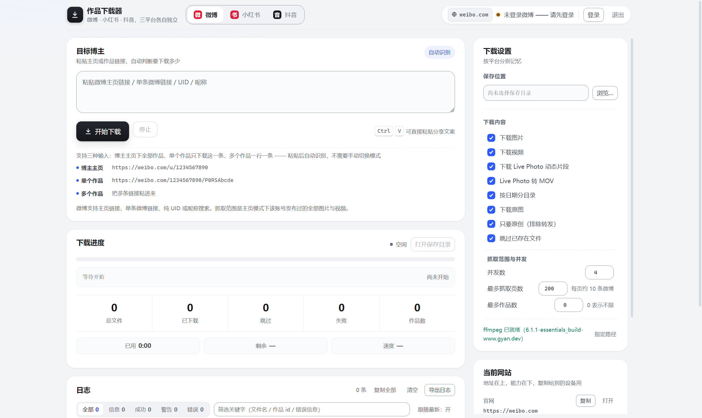
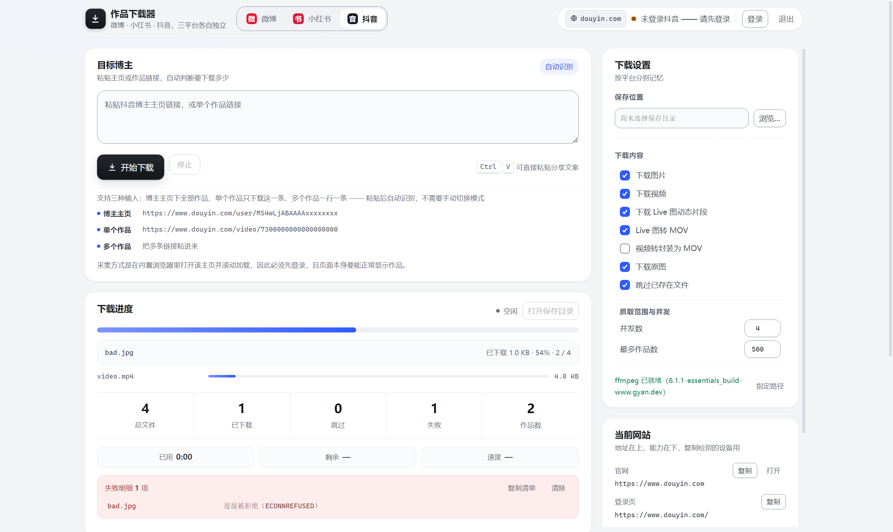
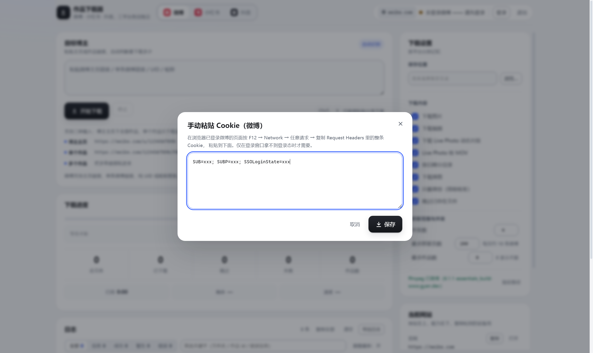
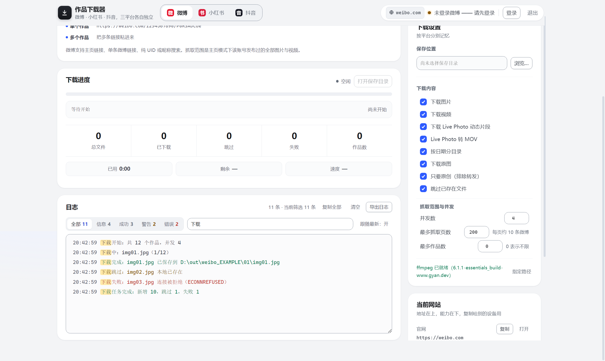
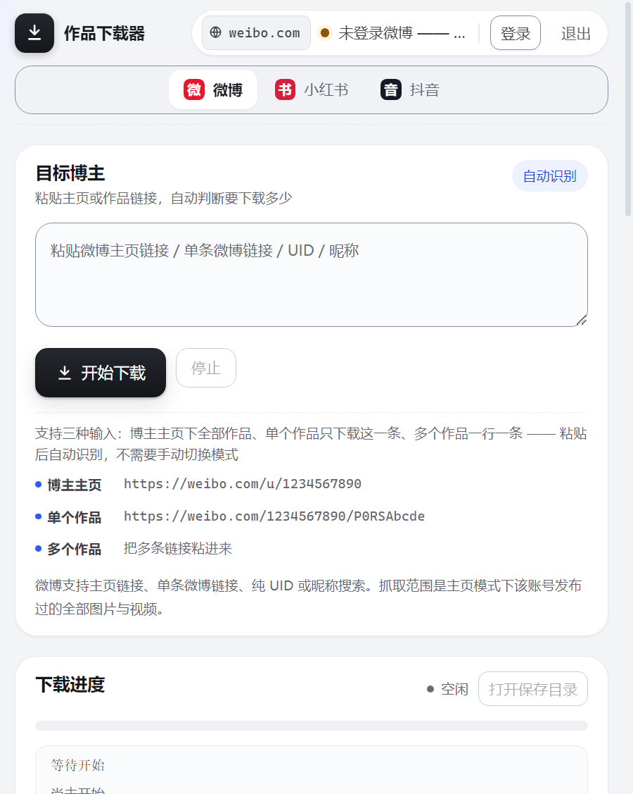
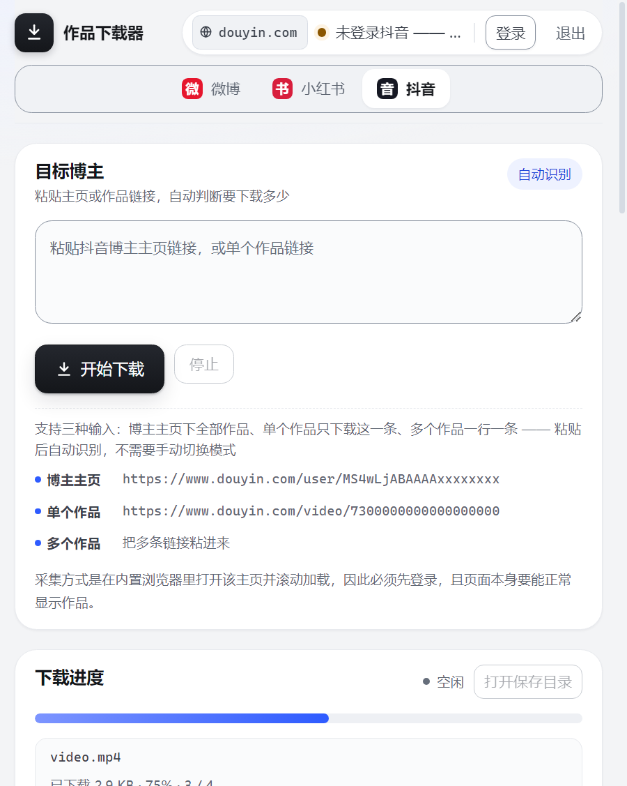
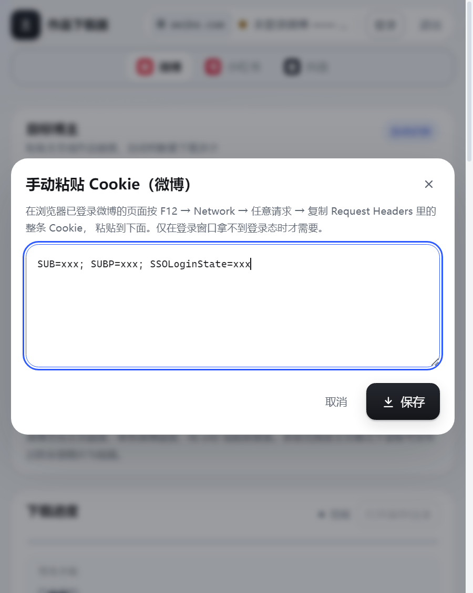
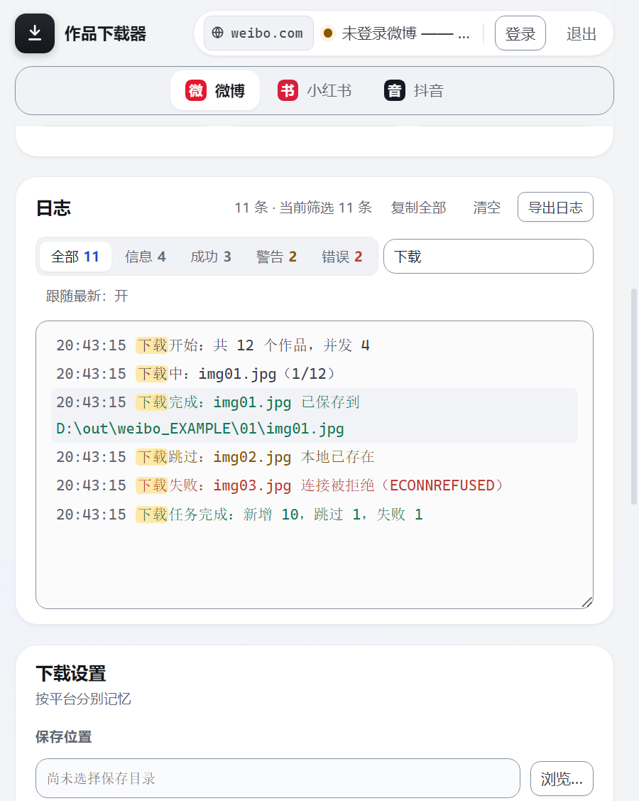

# 社交平台作品下载器

微博 / 小红书 / 抖音的作品批量下载器。粘贴博主主页或作品链接，自动判断要下多少，按原图画质保存到本地。

三个平台相互独立：各自一套登录态（独立 session 分区）、各自一套下载设置，互不干扰。



---

## 目录

- [功能](#功能)
- [截图](#截图)
- [环境要求](#环境要求)
- [安装与运行](#安装与运行)
- [使用说明](#使用说明)
- [下载设置](#下载设置)
- [数据与配置存放位置](#数据与配置存放位置)
- [开发](#开发)
- [打包与分发](#打包与分发)
- [目录结构](#目录结构)
- [隐私与免责](#隐私与免责)

---

## 功能

**输入**

- 三种输入自动识别，不需要手动切换模式：博主主页（下全部作品）、单个作品（只下这一条）、多个作品（一行一条，逐个下）
- 支持直接粘贴 App 分享文案，自动从中提取链接；短链会展开
- 粘错平台会提示，并给一个「切到 XX 并继续」的按钮（切换后刚粘的链接不会被覆盖）
- 微博额外支持纯 UID / 昵称搜索

**下载**

- 并发下载，每个文件独立进度条（大视频卡住一个文件也看得见在动）
- 实时速度、剩余时间、已用时间；总文件 / 已下载 / 跳过 / 失败 / 作品数五格统计
- 失败明细逐条列出（文件名 + 原因），可一键复制清单
- 跳过已存在文件、按日期分目录、下载原图
- 微博：只要原创（排除转发）
- 小红书 / 抖音：Live 图动态片段、视频转封装 MOV

**登录**

- 点「登录」弹出平台官方登录窗口，登录成功后自动关窗并回写状态（不做账号密码中转）
- 登录窗口标题常驻显示当前网站域名 —— 它没有地址栏，这是唯一能确认「正在登录哪个站点」的地方
- 顶栏常驻当前网站域名徽章，点击即复制完整地址
- 微博支持手动粘贴 Cookie（登录窗口拿不到登录态时的兜底）

**界面**

- 日志分级筛选（信息 / 成功 / 警告 / 错误）+ 关键字检索 + 「跟随最新」开关，最多保留 400 条
- 日志可复制、可导出为文件
- 响应式布局：1079 / 899 / 699 / 559 四档断点，窄到 527px 仍无横向溢出
- 全部颜色/字号/间距取自 `tokens.css`，遵循 WCAG AA（正文 4.5:1、控件与焦点环 3:1）
- 键盘可达：弹窗 Esc 关闭并归还焦点、Tab 在弹窗内循环、日志区可 Tab 进入翻看

## 截图

以下截图由 `npm run shots` 生成：启动真实应用、把界面摆成对应状态、跑一遍自检断言（`errors` 必须为空）后截图。
桌面端窗口 1427×900，窄屏窗口 527×700（高 DPI 下输出 2475×1477 / 900×1127）。

**桌面端**

| 首屏 | 下载中 |
|---|---|
|  |  |

| 手动 Cookie 弹窗 | 日志与筛选 |
|---|---|
|  |  |

**窄屏（单栏布局）**

| 首屏 | 下载中 |
|---|---|
|  |  |

| 弹窗 | 日志 |
|---|---|
|  |  |

## 环境要求

- Windows / macOS / Linux 桌面环境
- Node.js 18 或更高（开发时需要；只用打包好的可执行文件则不需要）
- Electron 28.3.3 作为运行环境

## 安装与运行

```bash
git clone <仓库地址>
cd social-downloader
npm install                # 安装 ffmpeg-static
npx electron@28.3.3 .      # 启动应用（首次会下载 Electron，之后走缓存）
```

> **为什么 Electron 不写进 `devDependencies`**：`tools/pack-asar.js` 会把整个
> `node_modules` 收进 asar，而 Electron 的 `dist/` 有几百 MB —— 装上它会让产物
> 从 0.9 MB 涨到几百 MB。运行环境与运行依赖分开管理，打包产物体积才可控。

首次使用建议顺序：

1. 点顶栏「登录」，在弹出的窗口里扫码 / 登录（三个平台各登录一次）
2. 选保存目录（右栏「保存位置」→ 浏览…）
3. 粘贴博主主页链接 → 开始下载

> 视频转 MOV / 合并音视频需要 ffmpeg。应用会优先使用随包附带的 `ffmpeg.exe`；
> 找不到时可用右栏「指定路径」手动指定，界面底部会实时显示 ffmpeg 状态与版本。

## 使用说明

**三种输入**

| 类型 | 行为 | 示例 |
|---|---|---|
| 博主主页 | 批量下载该作者的全部作品 | `https://weibo.com/u/1234567890` |
| 单个作品 | 只下载这一条（原图 / 原视频 / Live 图） | `https://weibo.com/1234567890/AbCdEfGh` |
| 多个作品 | 一行一条，逐个下载 | 把多条作品链接粘进来 |

粘贴后输入框上方会实时显示判定结果；右侧「目标」一行同步显示解析出的地址，点「复制」可直接取走。

**采集方式**

- 微博：接口直连，速度快，需要登录态
- 小红书 / 抖音：在内置浏览器里打开主页并滚动加载（这两个平台的主页数据由前端渲染），因此**必须先登录**，且页面本身要能正常显示作品

## 下载设置

右栏「下载设置」按平台分别记忆，切换平台不会互相覆盖。三个平台的选项**不完全相同**，界面按各平台自己的 schema 渲染。

**三个平台共有**

| 分组 | 选项 |
|---|---|
| 勾选 | 下载图片 / 下载视频 / Live 动态片段 / Live 转 MOV / 下载原图 / 跳过已存在文件 |
| 数字 | 并发数（1–16）、最多作品数 |

> 「Live 动态片段 / Live 转 MOV」这两项的文案随平台略有不同（微博写作 Live Photo，小红书 / 抖音写作 Live 图），行为是同一件事。

**各平台另有**

| 平台 | 独有选项 | 数量上限 |
|---|---|---|
| 微博 | 按日期分目录、只要原创（排除转发）、最多抓取页数（1–2000，每页约 10 条微博） | 最多作品数 **0 表示不限**（上限 20000） |
| 小红书 | 视频转封装为 MOV、逐篇补全图集（图集要逐篇打开详情才完整，较慢） | 最多作品数 **最少 1**（上限 5000） |
| 抖音 | 视频转封装为 MOV | 最多作品数 **最少 1**（上限 5000） |

标注「仅在博主主页模式生效」的选项 —— 微博的「只要原创 / 最多抓取页数 / 最多作品数」、小红书的「逐篇补全图集 / 最多作品数」、抖音的「最多作品数」—— 在「单个作品 / 多个作品」模式下会自动隐藏，值仍然保留，切回主页模式即恢复。

## 数据与配置存放位置

| 内容 | 位置 | 说明 |
|---|---|---|
| 设置（保存目录、各平台选项、上次输入） | `<userData>/settings.json` | 纯配置，不含凭证 |
| 登录指纹 | `<userData>/login-state.json` | 关键 Cookie 的 sha256 前 16 位，只用来判断「还是不是同一份凭证」，**不含凭证本身** |
| 手动 Cookie（仅微博） | `<userData>/auth.json` | 经 `safeStorage` 加密；系统不支持加密、或加密过程抛异常时降级为明文，并标记 `encrypted: false` |
| 平台 Cookie | Electron 分区 `persist:weibo` / `persist:xhs` / `persist:douyin` | 登录窗口写入，由 Chromium 自行管理 |
| 下载结果 | 右栏「保存位置」所选目录 | 文件名与分目录由各平台适配器决定 |

`<userData>` 在 Windows 上是 `%APPDATA%/social-downloader`。

## 开发

```bash
npm test           # 全部测试（426 个用例，零依赖，纯 Node 运行）
npm run test:list  # 逐个文件串行执行，便于定位
```

测试不依赖任何测试框架：`tools/run-tests.js` 扫描 `test/*.test.js`，每个文件单独进程执行，单文件超时 15s。渲染层通过 `test/lib/renderer-harness.js`（最小 DOM + vm 沙箱 + 手工 rAF 泵 + IPC 桩）在纯 Node 里跑真实 `app.js`，因此界面逻辑也有行为级回归。

**界面验收（真机冒烟）**

```bash
# 启动后等首帧落定，把状态、断言与截图写成 JSON + PNG
social-downloader.exe --smoke-out=D:/tmp/smoke.json --smoke-scene=progress --window-size=1440x900
```

- `--smoke-scene`：`idle`（干净首屏）/ `progress`（下载中）/ `modal`（Cookie 弹窗）/ `logs`（日志压力），默认 `progress`
- 断言结果并入 `errors`：`errors` 非空即失败，不需要人肉看 JSON
- 截图写在 `<smoke-out>.png`，失败只警告不判失败（无 GPU / 远程桌面常见）

已验收的五档视口：1427 / 1007 / 807 / 687 / 527，均 `errors=[]`、横向溢出 0。

**重新生成 README 截图**

```bash
set SD_ELECTRON_EXE=<你的 Electron 或已安装应用的 exe 绝对路径>
npm run shots              # 八张全部重拍
npm run shots -- 02        # 只重拍名字含 02 的两张
```

脚本会逐张校验 `errors` 与场景名，任一张不合格即以非 0 退出 —— 不会把「黑屏但存成了 PNG」当作成功。
`SD_ELECTRON_EXE` 指向 `electron.exe` 时截图取当前源码；指向已安装的应用时取 `app.asar`，
后者若比源码旧会主动告警（否则图会悄悄落后一轮）。

**约束**

- 渲染层 CSP 为 `script-src 'self'`：不引入框架、构建工具或任何外部资源
- `style.css` 里不允许出现颜色字面量，一律引用 `tokens.css`（由 `test/ui-tokens.test.js` 强制）

## 打包与分发

```bash
npm run pack                                  # 生成 dist/app.asar（含回读校验）
npm run install-asar -- "D:/path/to/resources" # 备份旧包并替换（校验 sha1）
# 或用环境变量：SD_INSTALL_DIR=D:/path/to/resources npm run install-asar
```

替换目标必须是 Electron 应用的 `resources/` 目录（即 `app.asar` 所在处），脚本会自动在同目录留一份带时间戳的 `.bak` 备份。

## 目录结构

```
src/
  main/                主进程
    main.js            启动、单实例、窗口生命周期
    app/               windows / login-window / smoke / settings / ipc/* 等
    core/              runner（任务编排）、downloader、harvester、browser-pool、net、limit …
    platforms/         weibo / xhs / douyin 适配器 + registry
    sources/           数据源实现
    url-parse.js       输入判定（主页 / 单作品 / 批量 / 其它平台）
  preload/             contextBridge 暴露的最小 IPC 面
  renderer/            index.html / style.css / tokens.css / app.js（无框架）
tools/                 run-tests / pack-asar / install-asar
test/                  426 个用例 + renderer-harness / electron-stub
docs/screenshots/      README 用截图
```

## 隐私与免责

- 本工具不提供、不内置任何账号，也不代理任何登录请求；登录全部发生在平台官方页面，凭证只留在本机
- 不做上传、不上报、不接任何第三方统计
- 下载内容受平台服务条款与著作权法约束，请仅用于**已获授权的内容**或**个人备份**；由使用方式引起的后果由使用者自行承担
- 仓库内不含任何真实账号、Cookie、令牌或本机路径；配置文件请自行用 `.env`（参考 `.env.example`，已被 `.gitignore` 排除）

## License

[MIT](LICENSE)
