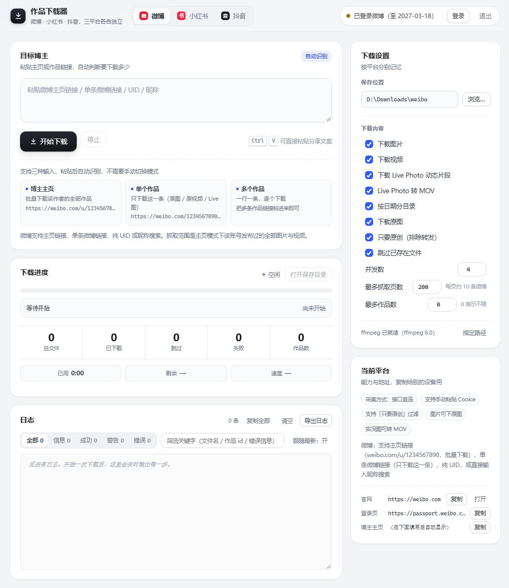
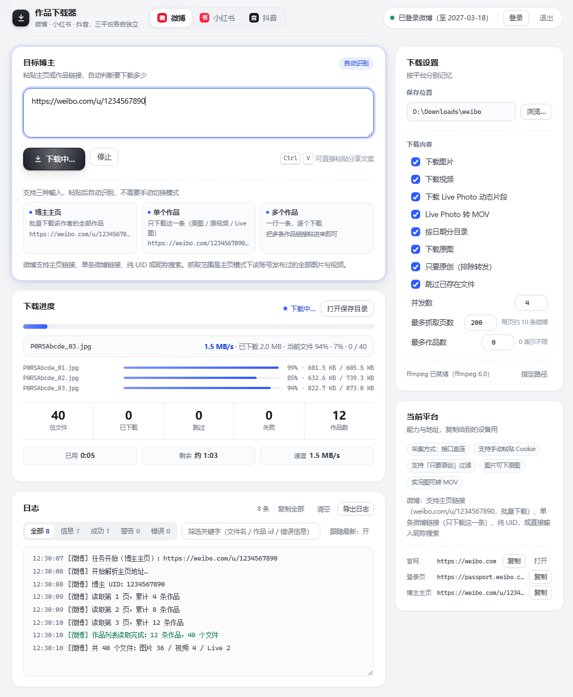
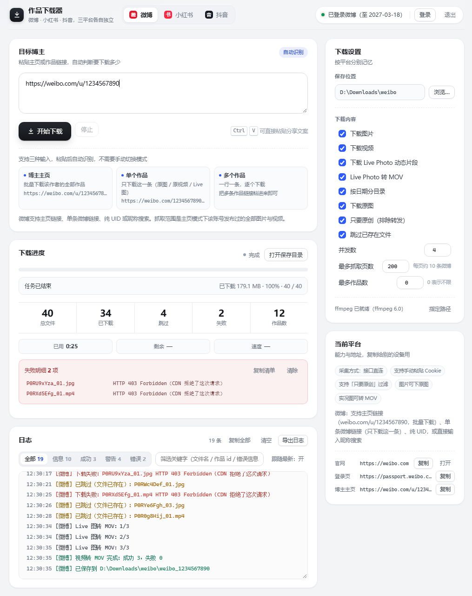
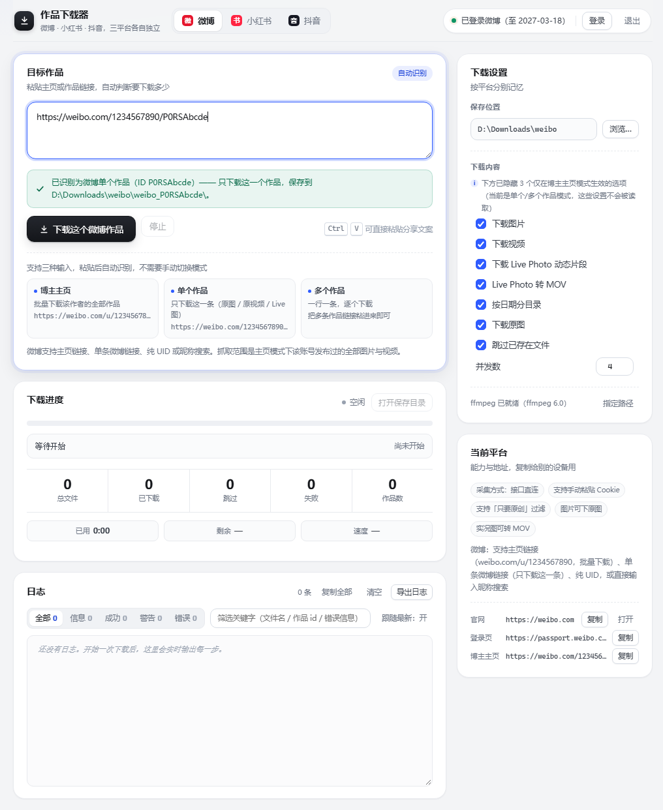
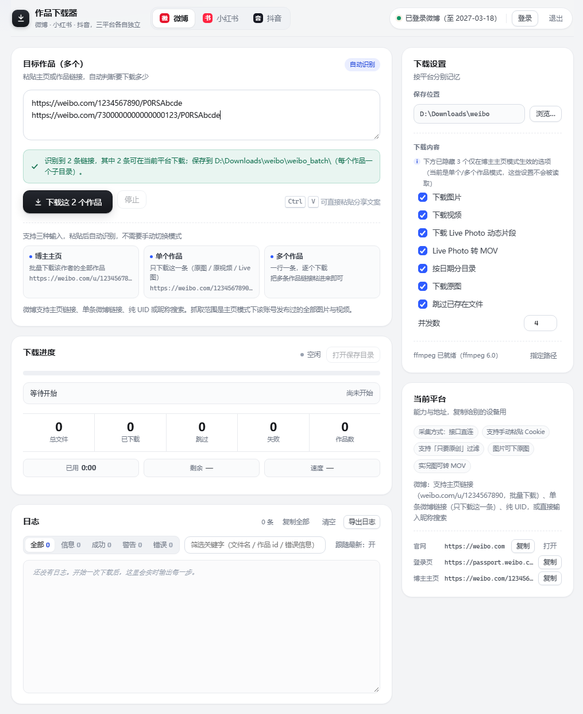
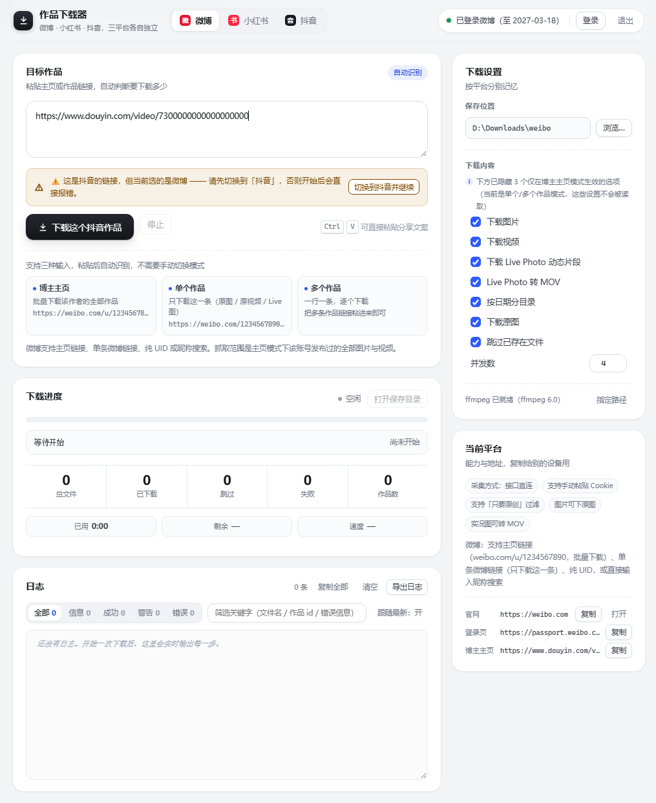
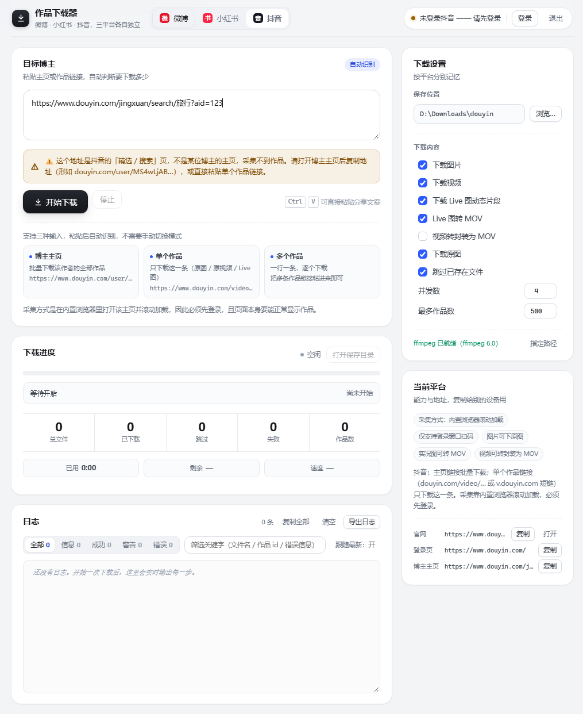
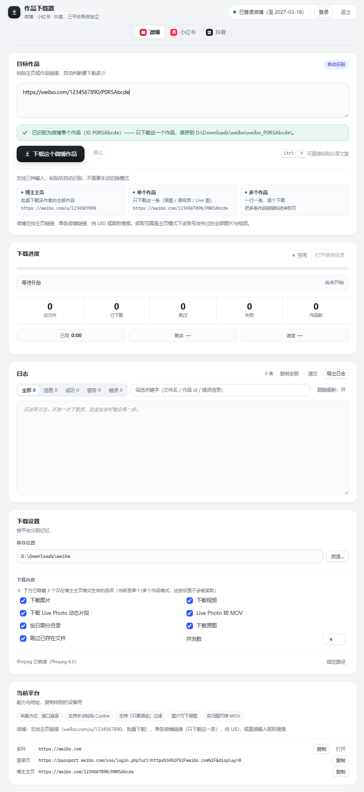

# 社交平台作品下载器

> 微博 / 小红书 / 抖音 博主作品批量下载器，另支持**单条作品下载**。三个平台各自独立适配、互不影响。

基于 Electron 28 的 Windows 桌面应用：粘贴博主主页链接即可批量抓取原图与原视频；
粘贴单个作品链接则只下载这一条。内置运行日志与实时下载进度，便于排查问题。

---

## 界面预览

主界面走「一屏完成主路径」：左栏从粘贴链接到进度、日志自上而下，右栏是各平台的下载设置与当前平台信息。
粘贴后自动识别链接类型，不需要手动切换模式。

<p align="center">
  
</p>

运行中会展开单文件细进度条，底部同时给出总进度、已用时间、剩余时间与速度：

<p align="center">
  
</p>

结束后进度区转为「完成」，失败项单独聚合成可复制的失败明细，日志按信息 / 成功 / 警告 / 错误分级计数：

<p align="center">
  
</p>

识别与拦截是使用体验里最容易出错的一环，下面四种状态直接给出结论和下一步动作：

| 单个作品识别 | 批量作品识别 |
|---|---|
|  |  |
| 只下载这一条，保存路径实时预览 | 逐条识别，可用条数与来源一并列出 |

| 跨平台链接提醒 | 无效页面拦截 |
|---|---|
|  |  |
| 平台不匹配时提示并可一键切换 | 抖音「精选 / 搜索」页会被拦下并说明原因 |

窗口变窄时布局塌成单列，标签页下沉、右栏设置移到页面末尾：

<p align="center">
  
</p>

> 截图目录：**`docs/images/`**（8 张 PNG，共约 1.3 MB）。
> 全部由 `docs/images` 同源的静态预览页在无头 Chromium 中按真实渲染结果截取，
> 视口 1020×1400（窄窗口为 900×2100），裁掉多余画布留白后入库，
> 因此与 `src/renderer/` 的实际界面一致，不含任何演示浮层或占位水印。

---

## 功能

| 功能 | 微博 | 小红书 | 抖音 |
|---|:---:|:---:|:---:|
| 博主主页批量下载 | ✅ 接口直连 | ✅ 内嵌浏览器采集 | ✅ 内嵌浏览器采集 |
| 单条作品下载 | ✅ | ✅ | ✅ |
| 多个作品链接批量 | ✅ | ✅ | ✅ |
| 登录态检测 | ✅ | ✅ | ✅ |
| 断点续传 / 失败重试 | ✅ | ✅ | ✅ |
| 运行日志（分级过滤 / 搜索 / 导出） | ✅ | ✅ | ✅ |
| 实时进度（总进度 + 单文件细条 + 速度 / ETA） | ✅ | ✅ | ✅ |

保存路径约定：

- 博主主页批量：`{保存目录}/{平台id}_{作者uid}/{日期}_{标题}_{作品id}/`
- 单条作品：`{保存目录}/{平台id}_{作品id}/`
- 多条作品：`{保存目录}/{平台id}_batch/{日期}_{标题}_{作品id}/`

平台 id 取适配器注册名：`weibo` / `xhs` / `douyin`。

---

## 环境要求

- Windows x64
- Node.js ≥ 18（仅用于跑测试与打包脚本，运行应用本身不需要）
- Electron 28（应用运行时；本仓库不含 Electron 依赖，见下方说明）

---

## 安装与运行

```bash
# 1. 安装依赖（只有 ffmpeg-static）
npm install

# 2. 跑测试，确认环境正常
npm test

# 3. 打包成 app.asar
npm run pack            # 产物：dist/app.asar

# 4. 装进已安装的应用目录（自动备份旧 asar，可回滚）
npm run install-asar -- "C:/Path/To/YourApp/resources"
```

> ⚠️ **安装前必须完全退出应用**。Windows 上正在运行的 Electron 会锁住 `app.asar`，
> 覆盖会直接 `EBUSY` / `EPERM` 失败（脚本会捕获并提示，不会留下半截文件）。

### 关于 Electron

本仓库**不含 Electron 运行时依赖**（`package.json` 里只有 `ffmpeg-static`），因此：

- ✅ 可以跑 `npm test`（纯 Node，渲染层用内置的最小 DOM 测试替身）
- ✅ 可以跑 `npm run pack` / `install-asar`
- ❌ 无法直接 `electron .` 起窗口 —— 需要先有一个 electron-builder 打好的应用壳，
  再用 `install-asar` 把 `app.asar` 换进去。

---

## 需自行配置的配置项

本仓库是**脱敏副本**，源码中所有可能含个人或凭证信息的字面量都已替换为占位符。
克隆后按下表回填即可；**填错类型会导致解析失败**（解析逻辑依赖 ID 的字符形态）。

| 占位符 | 含义 | 回填要求 | 不回填的影响 |
|---|---|---|---|
| `XHS_XSEC_TOKEN_PLACEHOLDER` | 小红书页面访问令牌（`xsec_token` 值） | 任意 4 位以上字母数字串 | 仅影响示例链接展示 |
| `DOUYIN_SEC_UID_PLACEHOLDER` | 抖音账号身份标识 `sec_uid` | 需以 `MS4wLjABAAAA` 开头 | 抖音主页链接解析用例失败 |
| `WEIBO_UID_PLACEHOLDER` | 微博账号 UID | **必须是 10 位纯数字** | 微博链接解析用例失败 |
| `XHS_USER_ID_PLACEHOLDER` | 小红书账号 ID | **必须是 24 位十六进制** | 小红书主页链接解析用例失败 |
| `XHS_NOTE_ID_PLACEHOLDER` | 小红书笔记 ID | **必须是 24 位十六进制** | 小红书作品链接解析用例失败 |

> 应用**运行期不需要**任何这些常量 —— 它们只出现在 UI 示例文案和测试夹具里。
> 真实的用户 ID / token 全部在运行时从页面或用户粘贴的链接里取得。

`tools/install-asar.js` 的默认安装目标是一个通用占位路径 `D:/Path/To/YourApp/resources`，
**几乎总要传参覆盖**：`npm run install-asar -- "C:/Apps/YourApp/resources"`。

### 环境变量

本项目**不需要任何环境变量**，也**不使用任何 API Key / Token / 密码**：

| 项 | 说明 |
|---|---|
| API Key / Secret | ❌ 不存在。三个平台均未使用开放平台 API，无需申请密钥 |
| 登录态 | 运行时从内嵌浏览器的会话中读取，存于本机 `%APPDATA%`，经系统级加密（`safeStorage`）落盘，**不进源码、不上传** |
| 数据库 | ❌ 无。仅用 `settings.json` 保存保存目录等偏好 |

唯一会读取的环境变量是可选的 ffmpeg 查找路径：

| 变量 | 用途 | 默认值 |
|---|---|---|
| `LOCALAPPDATA` | 定位 `%LOCALAPPDATA%\ffmpeg\bin\ffmpeg.exe` | 未设置则回退到 `C:\ffmpeg\bin\ffmpeg.exe`，再回退到 `ffmpeg-static` 自带二进制 |

`.env` 文件：**不存在，也不需要创建**。`.gitignore` 已把 `.env*`、各类密钥文件、
`auth.json`、`login-state.json`、`settings.json` 全部排除，防止误提交。

---

## 脱敏说明

本副本由 `tools/desensitize.js` 生成，规则与逐文件替换明细见 **[`docs/脱敏说明.md`](docs/脱敏说明.md)**，
机器可读清单见 [`docs/脱敏报告.json`](docs/脱敏报告.json)。

要点：

- 本次扫描源工程 **53 个文本文件**，命中 **10 个文件 / 47 处**，全部替换为语义化占位符。
- 已扫描并确认**命中 0**：API Key / 密钥 / 数据库连接串 / 私钥 / `.env` / 邮箱 / 手机号 / UUID / Cookie 字面量。
- 已替换：小红书 `xsec_token` 值、抖音 `sec_uid`、微博 UID、小红书账号与笔记 ID。
- 自动规则之外另做了人工收尾：`tools/install-asar.js` 里硬编码的本机安装路径已改为通用占位，
  本说明与报告自身的绝对路径也已去掉本机信息。
- 刻意保留：平台公开域名（`weibo.com` / `douyin.com` / `xiaohongshu.com` 等）——
  它们是协议常量而非私密信息，替换会让解析与采集逻辑整体失效。
  若需彻底脱敏（对外归档场景），执行 `node tools/desensitize.js <源> <输出> --strict`，
  会额外把域名与全部业务 ID 也换成占位符。
- Cookie 名（`ttwid` / `passport_csrf_token` / `SUBP` 等）是平台公开常量，代码中从未携带其值，予以保留。

另用一套与脱敏器不同源的规则做了独立交叉扫描（AccessKey / GitHub Token / `sk-` 密钥 /
Bearer / 私钥块 / 硬编码密码字段 / 本机用户路径 / 邮箱 / 手机号 / 身份证 / 内网 IP），
均 **0 命中**；仅有的 31 条 ID 形态命中经逐条核对，全部是键盘顺序数字与顺排十六进制的人工样例。

### 测试

```bash
npm test
```

| 副本 | 结果 |
|---|---|
| 原工程 | **268 / 268** 全部通过 |
| 本脱敏副本 | **255 / 268** |

未通过的 13 项全部集中在 3 个解析用例文件（`platform-contract` 2 项、
`single-download-edge` 5 项、`single-download` 6 项），原因统一是
「占位符不满足 ID 字符形态」（如 `WEIBO_UID_PLACEHOLDER` 不是 10 位纯数字）。
这是脱敏的预期代价，不是代码缺陷；按上表回填为合法值后即可全绿。
渲染层、日志、进度、限流、抖音输入守门与端到端用例均原样通过。

---

## 目录结构

```
.
├── src/
│   ├── main/                  # 主进程
│   │   ├── platforms/         # 三平台适配器（weibo / xhs / douyin）+ registry
│   │   ├── core/              # runner / downloader / harvester / net / ffmpeg
│   │   ├── sources/           # 数据源与解析器
│   │   ├── cookies.js         # 登录态判定与加密落盘
│   │   ├── login-probe.js     # 登录态探测
│   │   ├── url-guard.js       # URL 拦截与重复日志合并
│   │   └── url-parse.js       # 链接解析（主页 / 单作品 / 短链）
│   ├── preload/               # 预加载脚本
│   └── renderer/              # 界面（app.js / index.html / style.css）
├── test/                      # 纯 Node 测试（含渲染层 DOM 测试替身）
├── tools/
│   ├── pack-asar.js           # 源码 → dist/app.asar
│   ├── install-asar.js        # 装进已安装应用（自动备份）
│   ├── inspect-input.js       # 离线排查：给一个链接看它会被解析成什么
│   ├── desensitize.js         # 脱敏副本生成器
│   └── run-tests.js           # 测试跑批
└── docs/
    ├── 脱敏说明.md             # 脱敏规则与逐文件明细
    ├── 脱敏报告.json           # 机器可读的替换清单
    └── images/                # README 界面截图（8 张 PNG）
```

---

## 许可

本项目自身代码为 **MIT**（见 [`LICENSE`](LICENSE)）。

⚠️ 依赖的 `ffmpeg-static` 为 **GPL-3.0-or-later**。若你分发本软件的二进制形式，
请确保遵守 GPL-3.0 的相应义务。
